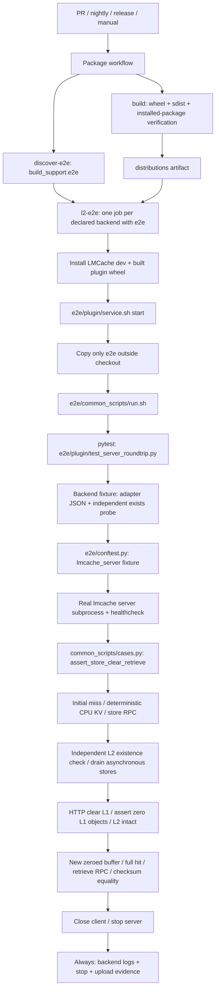

# Real-server L2 e2e

The package needs to verify real L2 persistence through LMCache without an
inference engine. Adapter benchmarks alone bypass the server and cannot prove
that clearing L1 causes retrieval from L2.

## Ownership and entry points

The public developer instructions live in
[the e2e guide](../source/developer_guide/e2e.md).

## Boundaries and tradeoffs

The existing plugin declaration registry supplies both package verification and
e2e discovery. Complete backend e2e folders opt in; partial folders fail early.
Each matrix job installs only its selected plugin extra and test dependencies.
The wheel comes from the same workflow run, with no cross-workflow artifact
lookup or revision matching. Running copied tests outside the checkout prevents
imports of the source package from hiding wheel defects.

The shared pytest fixture owns LMCache ports, command, readiness, logs and
process cleanup. It starts the real installed CLI and passes RPC/HTTP addresses
to the shared case. CLI and status API changes in LMCache may still require a
compatibility update here; the fixture does not hide that dependency. A separate
server wrapper module adds no useful boundary for this single caller.

Backend fixtures own configuration, SDK usage and independent persistence probes.
Backend lifecycle scripts own provisioning and cleanup; Compose is an Autumn
implementation choice, not a framework prerequisite. LMCache and pytest run
natively on the runner. Default UT remains under `tests/` and needs no services.

## Failure handling and validation

The fixture bounds readiness and shutdown and prints server logs even after
failure. CI collects backend diagnostics and attempts cleanup with `always()`;
JUnit, logs, source revisions, versions and the wheel checksum are artifacts.
The correctness case waits for asynchronous L2 stores before clearing L1 so that
in-flight buffers cannot be invalidated by the test itself. A backend probe
confirms actual persistence independently of the LMCache lookup result.

Validate discovery with `.github/tests`, build the documentation with warnings
as errors, and run the native e2e job against a real backend. A passing Autumn
case validates that adapter; each future backend needs its own real service run.
